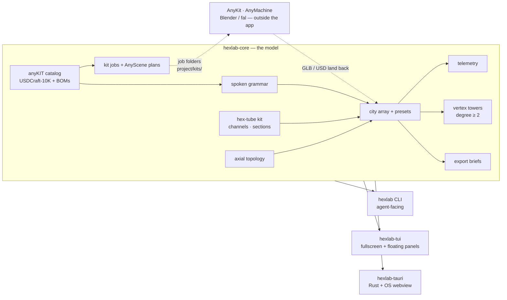
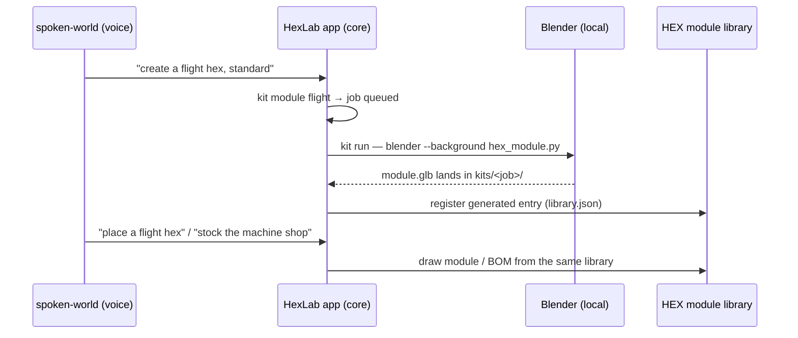

<!--
Ghost Catalog
SOM-DOC-10857-v1.1.0
HexLab local (Rust) — architecture: core, CLI, TUI, Tauri, anyMACHINE/anyKIT
-->

# HexLab Architecture

HexLab designs and builds platforms out of hexagons: a modular floating
Hex City, built as a direct reply to Palmer Luckey's square SLAB concept.
Hexagons link and tile face-to-face; each hex is a discrete inframodule;
vertex intersections stand vertical hex-tube towers (same kit, larger
diameter, turned up) carrying utilities and lifts; tuck swivel
propellers sit at the 120° three-way intersections.

The platform is **fully local Rust**. The web build
(`SoMaCoSF/hexlab-platform`, live at hexlab.somacosf.com) is the visual
reference; this repo is the local machine: one core crate, three
front-ends, and job folders for the generation pipelines.

## The hex-tube kit (anyMACHINE's construction set)

A horizontal cell is a hexagonal tube: centre corridor (~0.28 of
flat-to-flat), six radial utility wedges — **power, fresh water,
ballast, HVAC/air, data/fibre, waste/grey** — plus four extra channels
(seawater, fire main, fuel, life support) sharing wedges. Cell lengths
follow the ISO-container idea: 20 / 40 / 45 classes (6.1 / 12.2 / 13.7 m).
Size classes are flat-to-flat 16 / 32 / 64 / 128 m
(scout / standard / industrial / capital).

A **vertex tower** is the same module stood vertical at a vertex where
2+ cells meet, upscaled ×1.35, corridor ratio 0.32, 4.2 m storeys. It is
the vertical interconnect: risers for every channel in the union of its
cells, lifts, and — at the waterline — the tuck swivel propeller.

Face couplings carry the six primary channels cell-to-cell, so utility
and lift continuity is checkable from the model alone:
`hexlab city towers` and the telemetry's shared-face count are that
check in v1.

## Modules

Eight inframodules: Core (H1), Flight-Harbor (FH, swing/raise/lower
face gate), Drainable Dry-Dock (DD, ballast), Sub-Launching Harbor
(SH, moonpool), Refinery (RF), Desalination (DS), Lab (LB), Power (PW).
Presets: 7-hex recon (scout), 19-hex carrier hub (standard), sandbox.

## The library, and why the app is local

The point of the local Rust app (founder, 2026-11-18): the anyMACHINE
and anyKIT **creations** need a home — a **library of HEX-based
modules** — and generation needs **Blender, which runs locally**. A
web app can't drive your Blender; this app can. spoken-world provides
the voice that speaks to the library and the build; anyscene turns
any module or facility into a BOM and kits it out.

- **Library** (`core::library`): stock shelf = the 8 inframodules;
  every landed generation registers as a `Generated` entry with its
  artifact path. Persisted as `<project>/library.json`. One library —
  the city builder, spoken UX, and BOM flow all draw from it.
- **Generation** (`core::generate`): `run_job` finds Blender (PATH or
  standard install locations), runs `scripts/hex_module.py` headless
  (procedural hex-tube shell: outer wall, corridor wall, end rings —
  the shared substrate every module starts from), lands `module.glb`,
  flips the manifest to Ready, registers the library entry. **No
  Blender → the job stays Queued and says so.** Module fit-out
  (flight gate, moonpool, dry-dock floor) layers on the shell in the
  AnyMachine pipeline next.
- **AnyScene for modules** (`kit plan-module`): the room is the hex;
  the BOM is the shell plus the six primary channel wedges — anyscene
  kits out *any module*, not just whole facilities.

## anyKIT + anyMACHINE

- **anyKIT catalog** (`core::catalog`): the USDCraft-10K industrial
  harvest rebuilt — 31 assets with spoken nouns and footprints, and
  seven facility BOMs (woodshop, machine shop, fabrication, warehouse,
  process, power, robotics). The web repo's catalog file is a stub —
  Grok's full version never landed; this rebuild is canonical now.
- **Spoken** (`core::spoken`): the tier-0 local grammar from
  spoken-world's HexLab bridge — "install a band saw", "create a bom
  for a woodshop and stock it", "stock the machine shop". Local and
  free; a voice front-end (OS speech APIs) feeds the same parser.
- **Jobs** (`core::kit`): a folder under `project/kits/<id>/` with a
  manifest, the BOM/plan that feeds the pipeline, and a landing place
  for returned GLB/USD. Hex-module jobs generate *inside* the app via
  the local Blender (above); AnyKit prop generation (fal/Tripo/Meshy)
  still runs outside — it needs network + keys — and lands in the
  same job folders.
  `facility_bom_to_anyscene_plan` converts a BOM into an AnyScene plan
  (room = hex class, objects carry footprints + `usdcraft_path`,
  `generate: false` when the harvest has the mesh).

## Front-ends

| Front-end | Seat | State |
|---|---|---|
| `hexlab` CLI | Omarchy agents, scripts | shipped, tested |
| `hexlab-tui` | human at a terminal | shipped, tested (ratatui) |
| Tauri shell | desktop (Omarchy/Windows) | scaffold + first UI; builds on target machines with OS webview packages |
| Web (hexlab-platform) | public configurator | live, separate repo |

All three local front-ends share `hexlab-core` and the same city JSON
project files — real files, diffable, scriptable. Undo/multi-window
project handling is the next tranche: the city JSON + stocked list is
already the whole state, so an undo stack is a snapshot list over it.

## Provenance

Ported 1:1 where the web build had real code (`hexTubeKit.ts`,
`platformStore.ts`, `spokenBridge.ts`, the configurator's telemetry),
rebuilt where it didn't (the catalog), and fixed where it was wrong:
the web vertex map used a 0.94 visual inset for corner markers, so no
two cells ever shared a vertex and its thruster count read 0. Here
vertex identity uses true corners — the carrier stands 36 towers.
